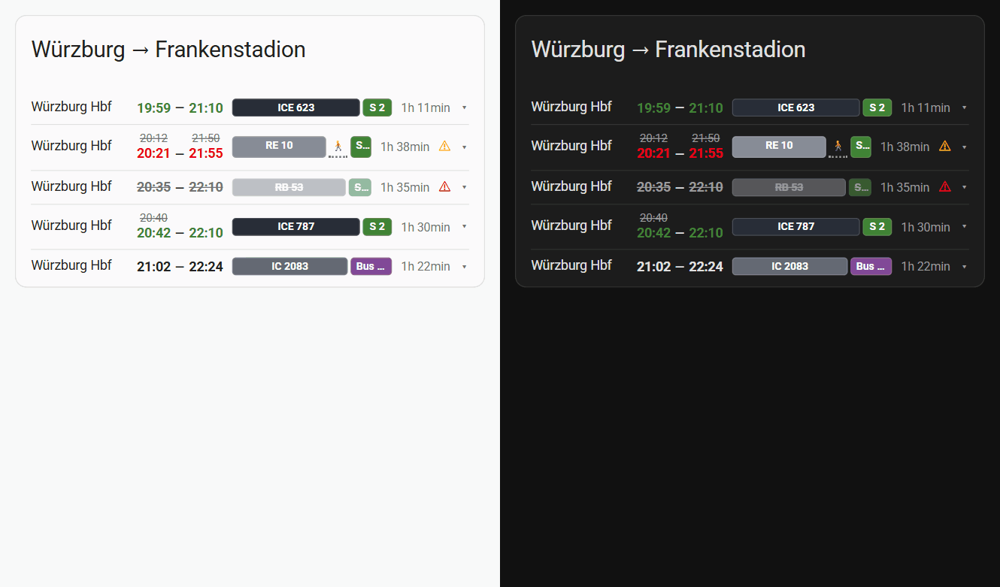
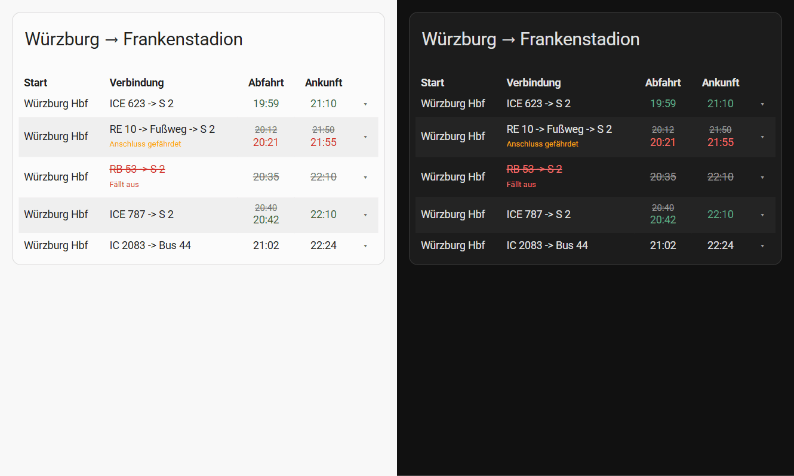
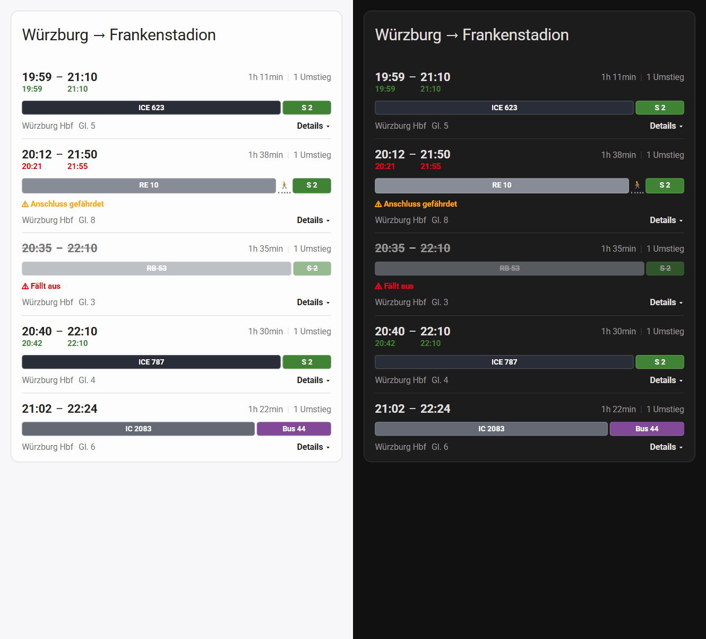

[](https://github.com/EiS94/db-info-card/releases/latest)
[](LICENSE)
[](https://github.com/EiS94/db-info-card/stargazers)
[](https://github.com/EiS94/db-info-card/actions/workflows/validate.yml)
[](https://github.com/hacs/integration)
[](https://github.com/EiS94/db-info-card/releases)

# 🚉 DB Info Card

A custom Lovelace card for [Home Assistant](https://www.home-assistant.io/) that displays Deutsche Bahn connections with
real-time data — as a compact table or in the look of bahn.de, with expandable connections showing every leg of the
journey.

> **Requires the [DB Info Integration](https://github.com/EiS94/db_info)**



---

## ✨ Features

- Displays the connections of a DB Info entry (1–5 configurable)
- Three [skins](#-skins): a compact table, a layout modelled on bahn.de and a one-line variant of it
- Real-time delays, cancellations and warnings such as "Anschluss gefährdet"
- Click a connection to expand its details (stops, platforms, train direction, per-segment delays, transfers)
- Follows your Home Assistant theme in light and dark mode
- Visual card editor in the Home Assistant style (no YAML required)

---

## 📋 Requirements

- [Home Assistant](https://www.home-assistant.io/) 2023.x or newer
- [DB Info Integration](https://github.com/EiS94/db_info) installed and configured

---

## 📥 Installation

### Via HACS

[](https://my.home-assistant.io/redirect/hacs_repository/?owner=EiS94&repository=db-info-card&category=plugin)

### Manual Installation

1. Download `db-info-card.js` from the [latest release](https://github.com/EiS94/db-info-card/releases/latest)
2. Copy it to `config/www/db-info-card.js`
3. In Home Assistant go to **Settings → Dashboards → Resources**
4. Add a new resource:
    - **URL:** `/local/db-info-card.js`
    - **Type:** JavaScript module
5. Reload your browser

---

## ⚙️ Configuration

### Visual Editor

The card ships with a built-in visual editor. When adding the card in the Lovelace UI, click **"DB Info Card"** and use
the editor to configure it — no YAML needed. The editor is built from Home Assistant's own form elements, so it looks
and behaves like the editors of the built-in cards, and the preview next to it updates while you change options.

The connection dropdown automatically detects all DB Info sensors and groups them by route (e.g.
`sensor.home_hbf_verbindung_1` through `_5` appear as a single entry `"Home → Hbf"`). The design dropdown switches
between the three [skins](#-skins).

### YAML Configuration

```yaml
type: custom:db-info-card
entity_prefix: sensor.home_hbf_verbindung_
title: Zuhause → Würzburg Hbf      # optional
skin: default                      # optional: default, db or db-compact
show_start: true                   # optional, default: true
show_problems: false               # optional, default: false
delay_threshold: 5                 # optional, default: 5
max_connections: 5                 # optional, default: 5
hide_city: Würzburg, Randersacker   # optional, comma-separated
```

### Options

| Option            | Type      | Default      | Description                                                                                                |
|-------------------|-----------|--------------|------------------------------------------------------------------------------------------------------------|
| `entity_prefix`   | `string`  | **required** | Prefix of the DB Info sensors, e.g. `sensor.home_hbf_verbindung_`                                         |
| `title`           | `string`  | _(none)_     | Card title shown in the header                                                                             |
| `skin`            | `string`  | `default`    | Look of the card: `default` (table), `db` (layout modelled on the connection list of bahn.de) or `db-compact` (the `db` look with one line per connection), see [Skins](#-skins) |
| `show_start`      | `boolean` | `true`       | Show or hide the "Start" column (in the `db` skin: the start stop and platform below the times)            |
| `show_problems`   | `boolean` | `false`      | Show warnings like "Anschluss gefährdet" directly below the connection name. They are always shown in the expanded details |
| `delay_threshold` | `number`  | `5`          | Minutes of delay from which the time is shown in red                                                       |
| `max_connections` | `number`  | `5`          | Number of connections to display (1–5). The integration always fetches 5; this limits how many are shown   |
| `hide_city`       | `string`  | _(none)_     | Hides city names in the start column, e.g. `Letzter Hieb, Würzburg` → `Letzter Hieb`, `Darmstadt-Wixhausen` → `Wixhausen`. Multiple cities can be given comma-separated (`Stuttgart, S-Feuerbach`) or as a YAML list |

---

## 🎨 Skins

The card comes with three skins, selected with the `skin` option or the design dropdown of the visual editor. The
images show the same five connections in each skin, in light and dark mode, while a connection is expanded.

### `default`

Compact table with one row per connection. Expanding a row shows a summary and every leg of the journey.



### `db`

Modelled on the connection list of bahn.de. Each connection shows departure and arrival time with the real-time value
below, duration and transfers, and a bar with one block per train. The expanded details are a timeline with stops,
platforms, train direction and transfer times. Trains are colour-coded by type as on bahn.de (e.g. long-distance dark,
regional grey, S-Bahn green, U-Bahn blue, tram burgundy, bus purple).



### `db-compact`

The `db` look in the footprint of the table. Collapsed, each connection is a single line with start stop, times, the
colour-coded train bar and the duration, so the card is as tall as with the `default` skin. Expanding a connection
shows the same timeline as the `db` skin.


### Theming

All skins follow your Home Assistant theme (light/dark). The `default` skin uses brighter status colours in dark mode
so that times stay readable. The colours can be overridden in a theme with `db-info-ontime-color` and
`db-info-late-color` (all skins), `db-info-red` (`db` skins) and `db-info-row-alternative-color` (zebra stripe of the
`default` skin).

---

## 🔍 Expanded Details

Clicking a connection expands it to show:

- **Summary:** Total duration, number of transfers and any problem notices (in the `default` skin also a delay badge)
- **Segments:** Each leg of the journey with departure/arrival stop, planned and real-time, and platform number — as a
  list in the `default` skin and as a timeline with travel and transfer times in the `db` skins. If the train continues
  beyond your stop, its final destination is shown next to the train name (e.g. `RE 9 → Frankfurt Hbf`), matching the
  platform display. Requires a DB Info version that provides `Departure Direction`

---

## ☕ Support

If you find this card useful, consider supporting the developer:
<a href="https://www.buymeacoffee.com/eis94" target="_blank"></a>